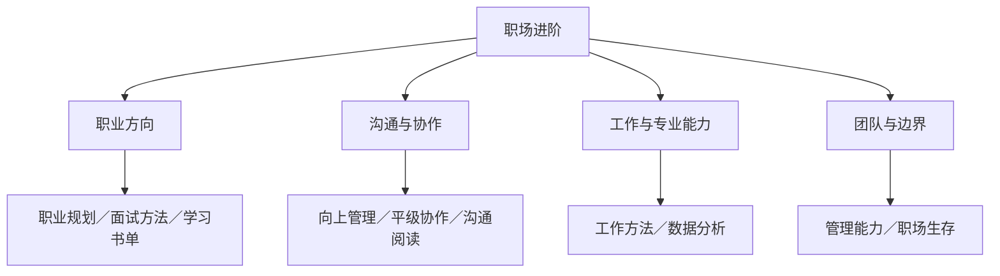

# 职场进阶知识库

围绕职业选择、业务判断、沟通协作与专业能力，回顾每篇笔记的核心收获。

## 知识总览

各主题内按已确认的笔记日期从早到晚排列；同日按标题排序，日期未知的条目放在主题末尾。日期来自正文的记录或整理日期；来源年份、迁移时间不当作创建时间。未确认的日期标为“待核实”。“已有个人思考”仅摘录原笔记明确标注的内容，其余不代写为你的感悟。

## 职业规划 · 3 篇

| 笔记 | 创建／整理时间 | 核心启发 | 已有个人思考 |
| --- | --- | --- | --- |
| [提前规划克服学习焦虑](./职业规划/提前规划克服学习焦虑.md) | 待核实 | 工作持续学不到东西就会焦虑——这不是你的问题，是成长的信号。应对方式不是"学更多"，而是"提前规划"。 | 未单独标注；见正文记录 |
| [普通人的四阶成长逻辑](./职业规划/普通人的四阶成长逻辑.md) | 待核实 | 普通人的成长有清晰可循的路径：思维模式 → 系统化管理 → 工程化平台化 → 提炼总结。每一步都是质变。 | 未单独标注；见正文记录 |
| [积极争取：机会不会主动找你](./职业规划/积极争取机会.md) | 待核实 | 职场中，起码要表现得积极。主动争取机会，不然好事凭什么轮到你。 | 未单独标注；见正文记录 |

## 面试方法 · 1 篇

| 笔记 | 创建／整理时间 | 核心启发 | 已有个人思考 |
| --- | --- | --- | --- |
| [面试不只是考试，而是一次"向高手借脑"的行业调研](./面试方法/面试是向高手借脑-3个偷师案例与4个习惯.md) | 2026-09-28 | 把面试当作行业调研：追问业务判断、人才画像和解决问题的方法。 | 将反问用于AI产品运营的竞品调研；阶段成果及时同步，用汇报争取资源。 |

## 向上管理 · 9 篇

| 笔记 | 创建／整理时间 | 核心启发 | 已有个人思考 |
| --- | --- | --- | --- |
| [复杂任务的求助策略](./向上管理/复杂任务的求助策略.md) | 2026-07-24 | 提前暴露目标达成的路径和资源问题，让领导有时间提供支持。 | 未单独标注；见正文记录 |
| [向上管理：预期管理 + 努力显性化](./向上管理/向上管理-预期管理与努力显性化.md) | 2026-07-25 | 汇报要管理预期，提出困难时同时给出解决方案。 | 只呈现结果会让协调、推动与克服阻力的工作被低估，应让隐形努力显性化。 |
| [职场表达的三个关键思维](./向上管理/职场表达的三个关键思维.md) | 2026-07-30 | 先判断战略方向，再明确沟通目的，表达时带上自己的判断。 | 未单独标注；见正文记录 |
| [关键人策略：向上两级管理](./向上管理/关键人策略：向上两级管理.md) | 待核实 | 升职加薪的关键人，不一定是你的直属领导。 判断清楚谁能真正影响你的职业发展，然后让那个人对你有足够的认知。 | 未单独标注；见正文记录 |
| [应对变化与经营目标的底层逻辑](./向上管理/应对变化与经营目标的底层逻辑.md) | 待核实 | 变化是常态，但万变不离其宗——始终围绕经营目标做判断，方向就不会偏。 | 未单独标注；见正文记录 |
| [新人如何在领导面前展露](./向上管理/新人如何在领导面前展露.md) | 待核实 | 把你自己当产品——先让市场（领导层）知道你的存在，再让客户（直属领导）了解你的价值。 | 未单独标注；见正文记录 |
| [新方案的汇报心法](./向上管理/新方案的汇报心法.md) | 待核实 | 新方案不只是把事想清楚，更要让领导看到你的视野、根基和主动性。 | 未单独标注；见正文记录 |
| [绩效考评的汇报策略](./向上管理/绩效考评的汇报策略.md) | 待核实 | 考评前的汇报，不是"述职"——是给领导提供一个帮你争取绩效的"弹药包"和"话术范本"。 | 未单独标注；见正文记录 |
| [让领导持续看见你的价值](./向上管理/让领导持续看见你的价值.md) | 待核实 | 领导不知道你在做什么 = 绩效一定不好。 这不是能力问题，是沟通方式的问题。你私下思考了很多、学习了很多，但如果没让领导知道，就等于没发生。 | 未单独标注；见正文记录 |

## 平级协作 · 2 篇

| 笔记 | 创建／整理时间 | 核心启发 | 已有个人思考 |
| --- | --- | --- | --- |
| [应对平级同事指导的策略](./平级协作/应对平级同事指导的策略.md) | 2026-07-24 | 工作中有其他人（尤其是平级同事）要"指导"你的工作时，一定要谨慎。不要把自己的位置放低，要强势一些。根据不同情况，用不同方式回应，既不失礼貌，也不失立场。 | 未单独标注；见正文记录 |
| [职场偷师：向身边人学习](./平级协作/职场偷师与取长补短.md) | 待核实 | 每个人都有值得你"偷"的东西——不只是知识，更是方法论、思维模式和解决问题的能力。 | 未单独标注；见正文记录 |

## 工作方法 · 3 篇

| 笔记 | 创建／整理时间 | 核心启发 | 已有个人思考 |
| --- | --- | --- | --- |
| [跳出执行者陷阱：从埋头苦干到抬头看路](./工作方法/跳出执行者陷阱：从埋头苦干到抬头看路.md) | 待核实 | 一直沉溺于做具体的事，是无法真正进步的。 执行是基本功，但只会执行的人，天花板清晰可见。 | 未单独标注；见正文记录 |
| [逻辑反应与边界设定](./工作方法/逻辑反应与边界设定.md) | 待核实 | 在混乱中理清逻辑、说服他人，同时守住自己的边界——既要"外功"也要"内功"。 | 未单独标注；见正文记录 |
| [高效工作的四个细节](./工作方法/高效工作的四个细节.md) | 待核实 | 表格突出重点，用看板回答高频问题，精简PPT，并具体表达认可。 | 未单独标注；见正文记录 |

## 专业能力 · 2 篇

| 笔记 | 创建／整理时间 | 核心启发 | 已有个人思考 |
| --- | --- | --- | --- |
| [案例一：短信推送数据异常排查 — 点击数大于推送成功数](./专业能力/数据分析/案例分析/案例一-短信推送数据异常排查.md) | 2026-07-25 | 先核对统计口径，再交叉验证推送与点击数据，定位异常来源；最终结论尚待补充。 | 未单独标注；见正文记录 |
| [SQL 技巧：筛选某字段累计总和 = 0 的客户标识](./专业能力/数据分析/工具技巧/SQL-筛选字段累计和为零的客户标识.md) | 2026-08-12 | 先明确累计范围，再用 GROUP BY 聚合客户、HAVING 筛选累计结果。 | 未单独标注；见正文记录 |

## 管理能力 · 1 篇

| 笔记 | 创建／整理时间 | 核心启发 | 已有个人思考 |
| --- | --- | --- | --- |
| [留人与安抚的艺术](./管理能力/留人与安抚的艺术.md) | 待核实 | 留人靠真心，安抚靠逻辑——管理不是技巧堆砌，是人心和事实的兼顾。 | 未单独标注；见正文记录 |

## 职场生存 · 1 篇

| 笔记 | 创建／整理时间 | 核心启发 | 已有个人思考 |
| --- | --- | --- | --- |
| [职场人情世故与自我保护](./职场生存/职场人情世故与自我保护.md) | 待核实 | 人情世故不是溜须拍马，是职场生存的基本功。 不懂规则的人，再能干也会吃亏。而自我保护，是规则里最重要的一条。 | 未单独标注；见正文记录 |

## 读书笔记 · 1 篇

| 笔记 | 创建／整理时间 | 核心启发 | 已有个人思考 |
| --- | --- | --- | --- |
| [《开口就是机会》阅读笔记](./读书笔记/开口就是机会/开口就是机会-阅读笔记.md) | 待核实 | 用结构化表达、信任积累与双赢沟通，推动资源争取、团队协作和个人成长。 | 未单独标注；见正文记录 |

## 学习书单 · 1 篇

| 笔记 | 创建／整理时间 | 核心启发 | 已有个人思考 |
| --- | --- | --- | --- |
| [产品 / 运营职业学习书单](./学习书单/产品运营书单.md) | 待核实 | 围绕产品与运营能力模型选书；《上瘾》以触发、行动、酬赏、投入解释习惯形成。 | 未单独标注；见正文记录 |

## 维护约定

新增笔记同步登记主题、原始创建日期、核心启发与明确记录的个人思考。公开内容保持脱敏；原笔记、配套图谱和历史记录保留。
